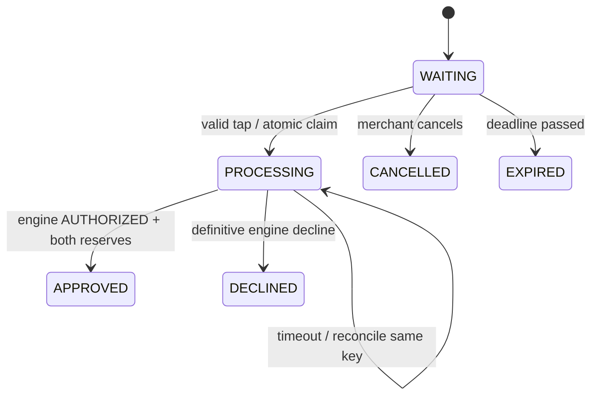
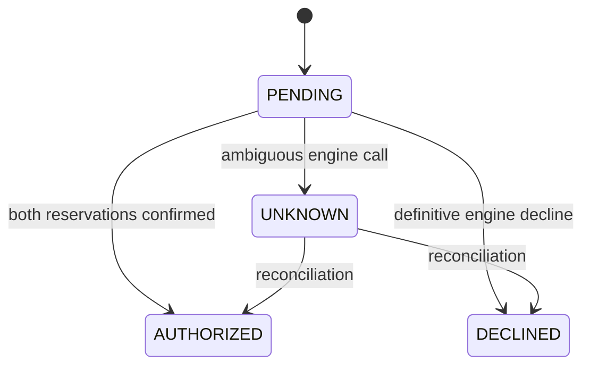
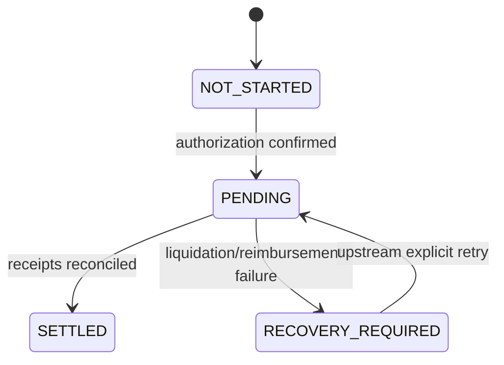

# Payment flow and state machines

## Synchronous authorization (planned)
1. Merchant creates a checkout with positive integer KRW amount and a terminal ID. Backend enforces a single live checkout per terminal and persists its expiry (proposed five minutes).
2. Galaxy opens `/terminal`, fetches the active checkout and starts Web NFC on an explicit button press. Decode one NDEF text record with the exact `vaultpay:card:<demo-id>` prefix. Ignore serial numbers and reject unexpected payloads. Tag is a demo lookup, not proof of identity.
3. Send terminal ID, explicit checkout ID and opaque card ID with a stable tap request key. Disable local repeats for usability; database uniqueness is the correctness guarantee.
4. Backend checks terminal, expiry, state, card enabled status and customer mapping. Atomically create the payment, claim PROCESSING and persist the engine request key/outbox event.
5. Adapter calls the engine with the stored amount. Engine validates identity/limits, eligibility/risk and company capacity, deterministically selects assets and reserves crypto including slippage buffer and KRW liquidity.
6. Only an explicit engine AUTHORIZED result with both reservations confirmed sets checkout APPROVED. An explicit decline sets DECLINED. Partial reservations must be compensated by the engine before its final decline; POS records reported states without inventing releases.
7. Persist the result and events in one database transaction. POS and terminal consume SSE and fetch backend state. Authorization approval is fast because liquidation is not awaited.

An approved or declined checkout is terminal; consecutive purchases create a new checkout ID. Processing sessions cannot be cancelled or expired into a new payment while the authorization is uncertain.

## Financial states (independent projection)

UNKNOWN remains financially unresolved and checkout stays PROCESSING. No automatic reversal after AUTHORIZED.

In these diagrams PENDING belongs to separate authorization and settlement fields. SETTLED requires the engine's reconciliation confirmation, treasury receipt and final release information, not merely a successful swap submission.

## Asynchronous settlement
The external engine liquidates reserved eligible crypto into USDC, transfers settlement assets to treasury, reconciles reimbursement and releases the remaining reservation. The POS backend only polls or consumes authenticated engine events, persists projections and emits SSE. Operations displays each reported timestamp, reservation, prefunding status, swap, treasury receipt, reimbursement and remaining hold.

If liquidation fails: authorization stays AUTHORIZED, checkout stays APPROVED, settlement becomes RECOVERY_REQUIRED. Preserve the latest reported reservations. The engine owns retry, compensation and recovery policy. A failure must never automatically release the entire reservation. A later explicit recovery event may return settlement to PENDING and eventually SETTLED.

## Demo scenarios for the implementation milestone
- Successful authorization, delayed settlement and explicit remaining-hold release.
- Definitive decline for ineligible assets, spending limit or insufficient prefunding.
- Two simultaneous taps and HTTP retry: exactly one payment/engine key.
- Engine timeout after accepting authorization: same-key reconciliation, no false decline.
- Settlement failure: approved purchase remains approved; recovery highlighted.
- Duplicate/stale settlement events: no duplicate entries or state regression.
- Restart during PROCESSING or settlement: durable reconciliation resumes.

## Galaxy local development
Use an NDEF-formatted demo tag, Samsung Galaxy Chrome with NFC enabled, a top-level page, an explicit scan gesture, and permission handling. Feature-detect NDEFReader and isSecureContext. Desktop/unsupported browsers show an unsupported message, not a fake hardware scan. Any later manual tap button must be labelled simulated and use the same backend validation.

Run `adb reverse tcp:5173 tcp:5173`, then browse `http://localhost:5173/terminal` on the phone. Vite proxies `/api` (including SSE) to laptop localhost:8000; only port 5173 needs reversing. Verify Chrome treats this loopback page as secure; plain LAN HTTP is unsuitable. Current scaffold only provides a route shell, not an NFC implementation.

References: [Chrome Web NFC requirements](https://developer.chrome.com/docs/capabilities/nfc), [Vite proxy configuration](https://vite.dev/config/server-options.html#server-proxy).
