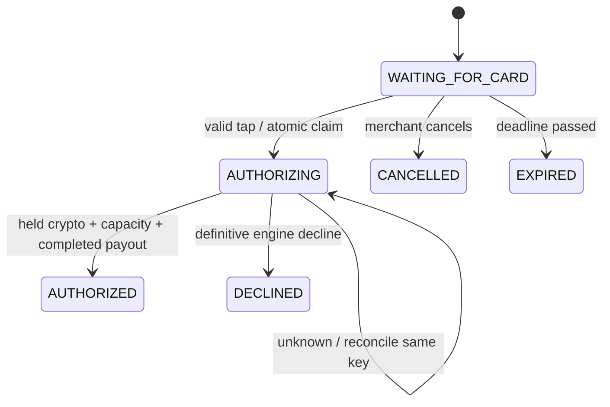
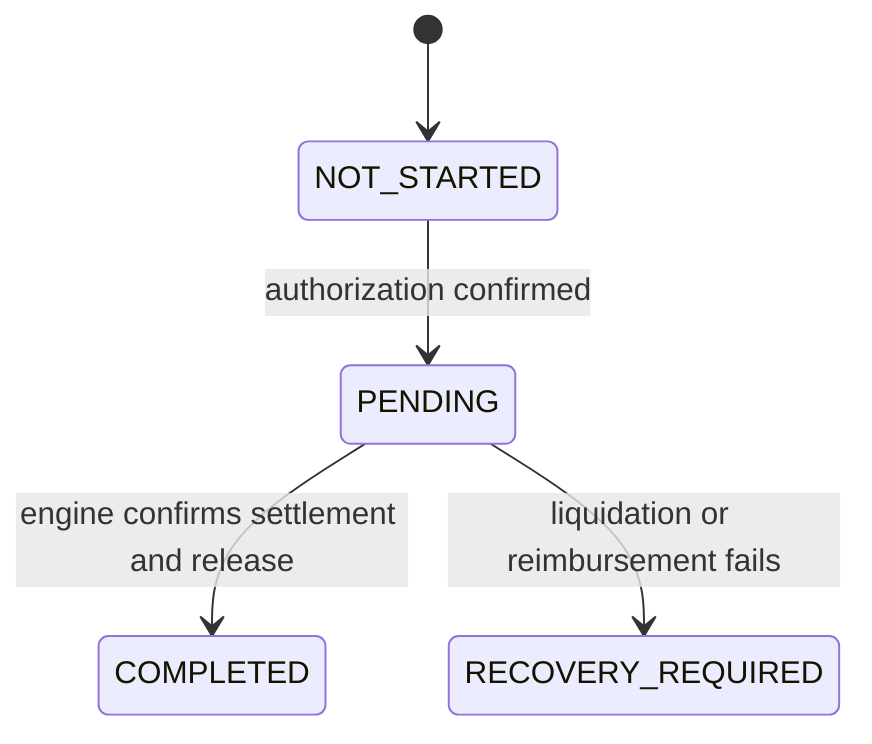

# Payment flow and state machines · Phase 2

## Synchronous phase
1. Merchant creates a KRW checkout for a registered terminal. Backend validates merchant ownership, expires previous waiting sessions and enforces one active checkout per terminal.
2. Terminal reads an NDEF alias (future frontend feature) and sends terminal_id, card_alias, client_event_id and preferably checkout_id. Swagger/curl can simulate this event without any NFC hardware.
3. Backend validates terminal/card, resolves the customer and server-stored amount, deduplicates the event, and atomically claims the checkout, creates its unique payment and appends status events.
4. Outside the SQLite transaction, call PaymentAdapter.authorize with **checkout_id as the idempotency key**. The engine requests a sufficient crypto hold from the Embedded Wallet, confirms it, reserves company KRW payment capacity and coordinates a simulated merchant KRW payout. Wallet custody, balances, holds and DEX execution remain external dependencies internal to the engine integration.
5. Only the engine's confirmed hold/capacity and explicit COMPLETED merchant payout allow a new authorization. Reserved company capacity alone does not establish merchant payment. Persist result and events atomically. Mock returns a definitive approval or decline immediately; frontend liquidation is never awaited.
6. Unknown/timeout outcomes stay AUTHORIZING with payment authorization PENDING and last_error set; worker looks up the original checkout key. No automatic decline or fresh payment key is created.

Only waiting sessions expire or can be cancelled. AUTHORIZED and DECLINED free the terminal for a new checkout. Old accepted client_event_id values continue to replay their original payment. A distinct delayed tap bound to an old checkout cannot consume the newer one.

## Independent financial projections
Authorization: PENDING → AUTHORIZED or DECLINED. A final authorization cannot be reversed by a later projection.

| Projection | States / expected normal path |
| --- | --- |
| Asset reservation | NOT_STARTED → PENDING → RESERVED → RELEASED; FAILED on pre-authorization failure |
| Company prefunding | NOT_STARTED → PENDING → RESERVED; FAILED on pre-authorization failure |
| Merchant payout (optional) | NOT_STARTED → PENDING → COMPLETED; FAILED prevents approval; null means unreported |
| Liquidation | NOT_STARTED → PENDING → PROCESSING → COMPLETED; FAILED requires recovery |
| Reimbursement | NOT_STARTED → PENDING → COMPLETED; FAILED requires recovery |

These are engine-reported values, not commands to reserve or release anything. Intermediate engine stages may be coalesced between polls; every received projection is validated. The initial accepted tap sets reservation and prefunding PENDING while the engine result is unknown.

Completed settlement requires liquidation and reimbursement COMPLETED and an explicit asset RELEASED projection. Company prefunding remains RESERVED because its requested state machine has no release state. RECOVERY_REQUIRED is terminal for this backend's current worker; an external recovery/retry protocol remains the engine team's responsibility.

## Asynchronous phase
After approval the Payment Engine instructs the Embedded Wallet to liquidate its reserved eligible crypto. The wallet executes the DEX swap; USDC reaches Company Treasury. The engine orchestrates reimbursement reconciliation and unused reservation release. The backend consumes adapter projections only. The mock produces scripted, explicitly simulated engine events over approximately three seconds (one second per stage by default).

On liquidation/reimbursement failure: checkout remains AUTHORIZED, payment authorization remains AUTHORIZED, asset hold stays RESERVED, settlement becomes RECOVERY_REQUIRED, and a reason/timestamp is shown to operations. No automatic authorization reversal or whole-reservation release occurs.

Worker polling and event history survive process restart. Poll leases serialize workers; a crashed owner is retried after its lease expires. Duplicate/stale engine versions emit no duplicate financial events. Completed financial stages cannot regress. No financial mutation/recovery endpoints are exposed to browsers.

## Demo scenarios
| Alias | Outcome |
| --- | --- |
| demo-alice | Authorization, simulated liquidation, reimbursement and release complete |
| demo-declined | Definitive decline: DEMO_SPENDING_LIMIT |
| demo-payout-fail | Hold/capacity reserved, merchant payout fails, purchase declined, no liquidation; engine owns compensation |
| demo-liquidation-fail | Approved purchase, failed liquidation, RECOVERY_REQUIRED, hold preserved |
| demo-reimbursement-fail | Approved purchase, completed liquidation, failed reimbursement, recovery with hold preserved |

All aliases map to seeded demo customers. Both galaxy-01 and galaxy-02 belong to merchant-demo. Actual engine selection, eligibility, financial risk, on-chain execution and ledger entries are out of scope.

## Future Galaxy frontend
The terminal route is still a shell. Implement an explicit scan gesture, NDEF text parsing (proposed tag format `vaultpay:card:<alias>`), permission/errors, feature detection and scan cancellation. Hardware serials are not authentication. Use a top-level secure Chrome context, compatible NDEF tag and enabled NFC hardware. Desktop should show unsupported hardware, with any manual tap clearly labelled simulated.

Run `adb reverse tcp:5173 tcp:5173`, then open `http://localhost:5173/terminal` on Galaxy Chrome; Vite proxies /api to laptop localhost:8000. Confirm window.isSecureContext on the device. Plain LAN HTTP is unsuitable. See [Chrome Web NFC requirements](https://developer.chrome.com/docs/capabilities/nfc).

## Compatibility and approval evidence
The optional merchant_payout_status is engine projection metadata in existing JSON storage. None of the checkout states, POS paths, tap request fields or existing financial enums change. Old authorized rows retain payout unknown rather than being backfilled. They are never re-paid. New authorization with missing/unconfirmed payout evidence remains AUTHORIZING for reconciliation. Mock duplicate taps and restarts reuse the checkout-keyed fixture and preserve the same merchant-paid timestamp, wallet instruction and settlement reference.
