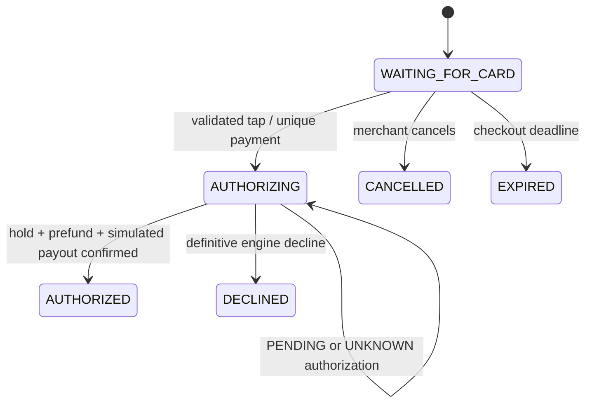
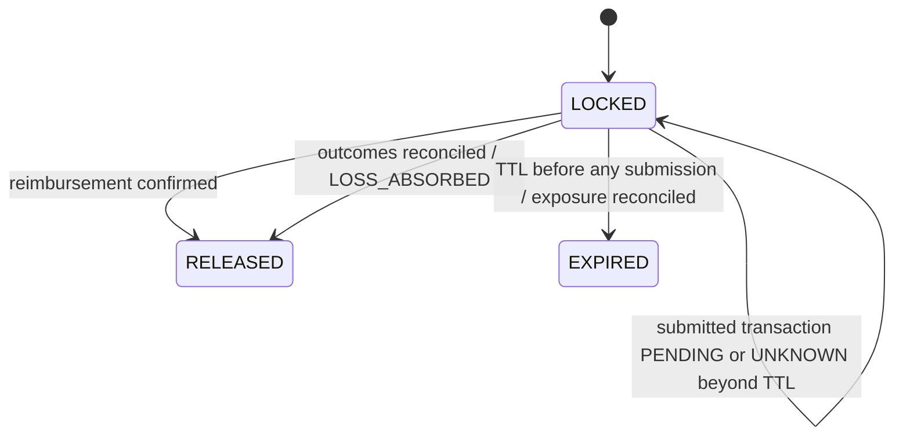

# Payment flow and states · Phase 3

The finalized prepaid-wallet specification overrides Phase 2's indefinite post-failure hold policy. POS endpoints, checkout/tap bodies and checkout states remain. The adapter simulates the aggregate external engine; it is not a real financial engine.

## Synchronous authorization
1. POS validates terminal/card, resolves the checkout amount/customer and atomically creates its unique payment; checkout becomes AUTHORIZING. The checkout UUID is the engine key, with client_event_id deduplication at POS.
2. Mock engine looks up the customer's **prepaid Embedded Wallet**. In one SQLite write transaction, acquire its entire exclusive lock and inspect the deposited snapshot. An existing lock returns WALLET_BUSY without modifying that lock.
3. Calculate `required_krw = ceil(amount_krw * (1 + MARGIN))`. Total wallet value below it gives LIMIT_EXCEEDED and releases the acquired lock.
4. Separately test the fixed router fixture's execution capacity under asset caps/leg budget. Insufficient execution returns EXECUTION_LIQUIDITY_UNAVAILABLE, not LIMIT_EXCEEDED.
5. Check/reserve company KRW capacity, record HOLD_PLACED, execute a simulated merchant payout and return AUTHORIZED. Company capacity failure releases the wallet. A definitive payout failure returns unused company capacity, declines and explicitly releases the lock.
6. Authorization returns before any swap is submitted. Background get_payment calls advance due mock steps. The POS performs no wallet or DEX calls.

A new checkout may use the terminal after authorization, but the same wallet cannot pay again until settlement/reconciled loss releases it. Deposits are allowed into the wallet but do not unlock it. All mock withdrawal/other-spending helpers reject locked wallets, including assets not selected for liquidation.

## Independent projections
| Field | State model |
| --- | --- |
| Authorization | PENDING / UNKNOWN → AUTHORIZED or DECLINED; final decisions do not reverse |
| Whole-wallet hold | NOT_LOCKED → LOCKED → RELEASED or EXPIRED |
| Asset reservation (compatibility) | NOT_STARTED / PENDING → RESERVED → RELEASED; existing FAILED retained |
| Company prefunding | NOT_STARTED → PENDING → RESERVED or FAILED |
| Merchant payout (optional) | NOT_STARTED → PENDING → COMPLETED or FAILED |
| Liquidation | NOT_STARTED → PENDING → PROCESSING → COMPLETED or FAILED |
| Reimbursement | NOT_STARTED → PENDING → COMPLETED or FAILED |
| Recovery | PENDING → REIMBURSED or LOSS_ABSORBED |
| Settlement (compatibility) | NOT_STARTED → PENDING → COMPLETED or RECOVERY_REQUIRED |

New hold/recovery/transaction projections live in existing engine-detail JSON; only the authorization enum adds UNKNOWN to the database constraint. Existing financial projections and checkout models remain available. Terminal recovery is now explicit: settlement RECOVERY_REQUIRED + recovery PENDING means unresolved; RECOVERY_REQUIRED + LOSS_ABSORBED means a reconciled company loss, with historical failure still visible.

## Background simulation
LIQUIDATION_STARTED → deterministic fixture asset selection → DEX_SWAP_SUBMITTED → confirmed/known-failed/unknown status. Default ranking is BTC, ETH, USDC, USDT; stablecoins are not prioritized. This is a hand-authored v5-shaped fixture, not the actual v5 model or financial optimizer. Only deposited values count.

A payment has at most **3 total submissions including retries**, at most 3 legs, and at most 2 retries per individual route/asset swap. Fallbacks consume that same budget. BTC failure followed by ETH failure and one ETH retry uses all 3 submissions. Maximum submitted slippage is 0.5%; a higher quoted fixture simulates a rejection, not a fill. Non-stablecoins have a 30% per-asset opening-day value cap, reduced by prior confirmed sells. Stablecoins have no percentage cap. Positive executable assets alone count toward the leg budget.

Only confirmed swaps debit simulated holdings and update daily sold amounts. Successful liquidation produces simulated USDC; treasury receives the merchant amount, recovery becomes REIMBURSED, and unused/excess proceeds are credited to the customer's wallet as simulated USDC before HOLD_RELEASED. Normal flow takes roughly three configured mock stage intervals. Failed/retried/unknown flows take longer. Values and fixed quotes are presentation fixtures, not real crypto balances or market prices.

## Failure, exposure and release policy
Exhaust configured fallback/retry capacity, record LIQUIDATION_FAILED and unpaid_exposure_krw, retain AUTHORIZED and hold LOCKED. A separate mock reconciliation step confirms all submitted outcomes and applies LOSS_ABSORBED. Record loss_absorbed_krw and then release the whole wallet explicitly. There is no AUTHORIZED → FAILED reversal. Historical settlement stays RECOVERY_REQUIRED; the recovery field records that the company has absorbed the loss. Unpaid exposure remains visible instead of disappearing.

The demo company absorbs the full merchant payment and does not regain that KRW capacity. Confirmed proceeds not delivered to treasury are returned as simulated USDC to the customer. A reimbursement-failure fixture models a definitively failed treasury delivery, not a transfer of unknown outcome. This exact refund/loss accounting and the swap-budget interpretation remain assumptions for team confirmation.

If HOLD_TTL expires before the first swap submission, submit nothing: record HOLD_EXPIRED, preserve authorization, record exposure/LOSS_ABSORBED and release with hold EXPIRED. An unknown merchant payout is reconciled before releasing its lock; a subsequently authorized payment whose pre-submission deadline has passed follows that expiry policy.

Pending/unknown submitted blockchain outcomes never unlock solely because TTL elapsed. The scripted transaction remains PENDING/UNKNOWN and locked until mock reconciliation confirms or fails it. Incoming deposits, restart and repeat polls cannot remove that lock. Protected demo reset also refuses unresolved submitted swaps.

Defaults: MARGIN=0.03, MAX_SLIPPAGE=0.005, HOLD_TTL=300 seconds. Set VAULTPAY_MOCK_HOLD_TTL=60 for presentations. Stage/unknown delays are configurable. Policies are persisted per payment; restart retains its original deadlines and routes. Daily budgets use the opening UTC-day fixture basis, fixed across a locked payment; incoming deposits cannot increase today's non-stablecoin cap. A new unlocked-day payment refreshes the basis.

## Scenarios available without frontend
| Alias | Scripted outcome |
| --- | --- |
| demo-alice | Hold, prefund, payout, BTC-first liquidation, reimbursement, excess return and release |
| demo-declined | LIMIT_EXCEEDED, acquired wallet lock released |
| demo-wallet-busy | Prelocked fixture, WALLET_BUSY; existing owner unchanged |
| demo-execution-fail | Enough total balance, but insufficient executable value under caps |
| demo-prefund-fail | Company capacity unavailable; acquired lock released |
| demo-payout-fail | Definitive mock merchant payout failure; decline, unused capacity/lock released |
| demo-hold-expiry | Authorized, deliberately delayed before submission until hold deadline; expiry/exposure/loss |
| demo-slippage-fail | Three rejected submissions for one swap, two retries, then loss reconciliation |
| demo-alternate | BTC route fails, ETH fallback succeeds |
| demo-liquidation-fail | BTC fails, ETH fallback and retry fail, then LOSS_ABSORBED |
| demo-reimbursement-fail | Liquidation confirms, treasury delivery fails definitively, loss/refund/release |
| demo-unknown | First submitted swap becomes UNKNOWN, retains lock beyond TTL if needed, later confirms |
| demo-authorization-unknown | Payout decision UNKNOWN, later approves; no premature unlock |
| demo-usdt | Prepaid USDT-only wallet, stablecoin percentage cap absent |

All cards map to seeded demo customers/wallets. Different checkouts using the same card exercise whole-wallet concurrency. Repeated event/checkout IDs exercise idempotency. Fake-clock tests cover expiry and unknown outcomes without long sleeps. Engine events persist customer/wallet/payment/checkout IDs, event ID/type, timestamp, states, asset metadata and recovery outcome, and propagate through the POS outbox once.

## External ownership and future frontend
Embedded Wallet owns custody, available balances, holds and wallet-controlled liquidation. Payment Engine coordinates wallet instructions, KRW capacity, merchant payment, treasury reconciliation and recovery. This repository mocks that aggregate behind the existing PaymentAdapter. Phase 7A adds opt-in external authorization and internal Ops polling under the frozen shared contract. Default startup uses the mock. No wallet, DEX, smart contract, bank or subscription optimizer is implemented here. See api-contract.md for sparse external authorization and unreported financial-detail handling.

The frontend remains a route shell. Future NFC uses an explicit gesture, NDEF alias parsing and Galaxy Chrome permissions in a secure top-level context. `adb reverse tcp:5173 tcp:5173` enables localhost testing through Vite's API proxy; hardware scanning is still a later UI milestone.
